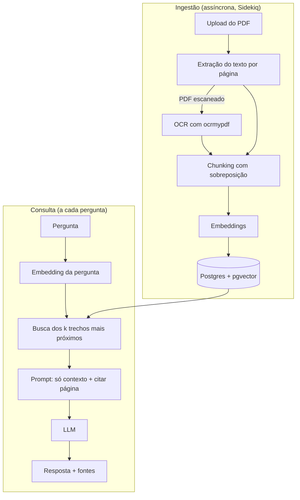

# rag_rails

Um RAG (Retrieval-Augmented Generation) em **Ruby on Rails** que responde perguntas sobre um PDF e **cita a página** de onde tirou a resposta.

> **Projeto de estudo.** Não é um serviço hospedado nem um produto: você roda localmente com a sua própria chave de API e o seu próprio PDF. O código é independente e não é afiliado a nenhuma marca de veículo ou fabricante citada em exemplos.

## Sumário

- [Como funciona](#como-funciona)
- [Stack](#stack)
- [Início rápido](#início-rápido)
- [Configuração](#configuração)
- [Usando a API](#usando-a-api)
- [Avaliando a qualidade](#avaliando-a-qualidade)
- [Estrutura do projeto](#estrutura-do-projeto)
- [Decisões de design](#decisões-de-design)
- [Limitações conhecidas](#limitações-conhecidas)
- [Segurança e privacidade](#segurança-e-privacidade)
- [Solução de problemas](#solução-de-problemas)
- [Roadmap](#roadmap)
- [Contribuindo](#contribuindo)
- [Licença](#licença)

## Como funciona

O fluxo tem duas fases: **ingestão** (uma vez por PDF) e **consulta** (a cada pergunta).



1. **Extração:** o texto é lido página por página; se o PDF não tiver texto (escaneado), roda OCR.
2. **Chunking:** cada página é dividida em trechos de ~3000 caracteres com 400 de sobreposição, guardando o número da página.
3. **Embeddings:** cada trecho vira um vetor (1536 dimensões) salvo no Postgres com pgvector.
4. **Consulta:** a pergunta também vira vetor, e os trechos mais próximos (distância de cosseno) entram no prompt.
5. **Resposta:** o modelo é instruído a responder **somente** com o contexto, citar a página (`[p. 3]`) e dizer "Não encontrei isso no documento." quando o contexto não cobrir a pergunta.

## Stack

| Camada | Tecnologia |
|---|---|
| API | Ruby on Rails (API-only) + Grape |
| Jobs | Sidekiq + Redis |
| Banco | PostgreSQL + pgvector (gem `neighbor`) |
| Arquivos | Active Storage (disco local) |
| Extração de PDF | `pdf-reader`; OCR com `ocrmypdf` + Tesseract |
| Embeddings e geração | Gemini (API REST, sem SDK) |
| Infra local | Docker Compose |

## Início rápido

### Pré-requisitos

- Docker e Docker Compose
- Uma chave de API do Gemini (crie no Google AI Studio)
- Um PDF para testar

### Passo a passo

```bash
git clone https://github.com/diiegopaiivam/rag_rails.git
cd rag_rails

cp .env-example .env                 # preencha GEMINI_API_KEY
docker compose build
docker compose run --rm web bin/rails active_storage:install
docker compose up -d
docker compose exec web bin/rails db:migrate   # se as tabelas ainda não existirem

curl localhost:3000/up               # deve responder 200
```

Acompanhe os logs com `docker compose logs -f web sidekiq`.

### O que sobe

| Serviço | Função | Porta no host |
|---|---|---|
| `web` | API Rails | 3000 |
| `sidekiq` | Processa a ingestão dos PDFs | — |
| `db` | Postgres 16 com pgvector | 5433 |
| `redis` | Fila do Sidekiq | — |

> `web` e `sidekiq` compartilham o volume do projeto: o upload é salvo em `storage/` pelo `web` e lido pelo `sidekiq`. Se você separar os volumes, a ingestão falha por não achar o arquivo.

## Configuração

Variáveis de ambiente (arquivo `.env`):

| Variável | Obrigatória | Descrição | Padrão |
|---|---|---|---|
| `GEMINI_API_KEY` | sim | Chave da API do Gemini | — |
| `GEMINI_LLM_MODEL` | não | Modelo de geração | `gemini-2.5-flash` |
| `GEMINI_EMBED_MODEL` | não | Modelo de embeddings | `gemini-embedding-001` |

> Deixe `GEMINI_LLM_MODEL` e `GEMINI_EMBED_MODEL` **comentadas ou ausentes** se quiser os padrões. Uma variável presente e vazia pode ser lida como string vazia. Confira os nomes de modelos vigentes na documentação do Gemini, pois eles mudam com frequência.

Parâmetros do pipeline (ajuste olhando o resultado da [avaliação](#avaliando-a-qualidade)):

| Parâmetro | Onde | Valor | Efeito |
|---|---|---|---|
| `SIZE` | `Chunker` | 3000 caracteres | Tamanho máximo do trecho |
| `OVERLAP` | `Chunker` | 400 caracteres | Repetição entre trechos vizinhos |
| `TOP_K` | `RagAnswerer` | 6 | Quantos trechos vão para o prompt |
| Dimensão | migration | 1536 | Precisa bater com o modelo de embedding |

## Usando a API

### Enviar um PDF

```bash
curl -F "file=@manual.pdf" localhost:3000/api/v1/documents
# {"id": 1, "status": "pending"}
```

Aceita apenas PDF, até 50 MB. A indexação roda em background.

### Acompanhar a indexação

```bash
curl localhost:3000/api/v1/documents/1
# {"id":1,"title":"manual.pdf","status":"ready","pages":412,"chunks":530,"error":null}
```

Estados: `pending` → `processing` → `ready` (ou `failed`, com o motivo em `error`).

### Fazer uma pergunta

```bash
curl -X POST localhost:3000/api/v1/documents/1/ask \
  -H "Content-Type: application/json" \
  -d '{"question": "Qual a pressão recomendada dos pneus?"}'
```

```json
{
  "answer": "A pressão recomendada é ... [p. 123]",
  "sources": [
    { "page": 123, "snippet": "trecho do documento...", "distance": 0.231 }
  ]
}
```

Perguntar a um documento que ainda não está `ready` retorna `409`.

## Avaliando a qualidade

"Parece funcionar" não é métrica. O projeto inclui um avaliador que roda um conjunto de perguntas com respostas conferidas por você.

1. Edite `eval/golden.yml` com perguntas do **seu** documento:

```yaml
- question: "Qual a pressão recomendada dos pneus?"
  expected_pages: [123]      # índice da página no PDF (começa em 1), NÃO o número impresso
  must_include: ["32"]       # trechos que a resposta correta precisa conter

- question: "Qual a capital da França?"
  should_refuse: true        # fora do escopo: o certo é "Não encontrei"
```

2. Rode:

```bash
docker compose exec web bin/rails rag:eval DOCUMENT_ID=1 SLEEP=1