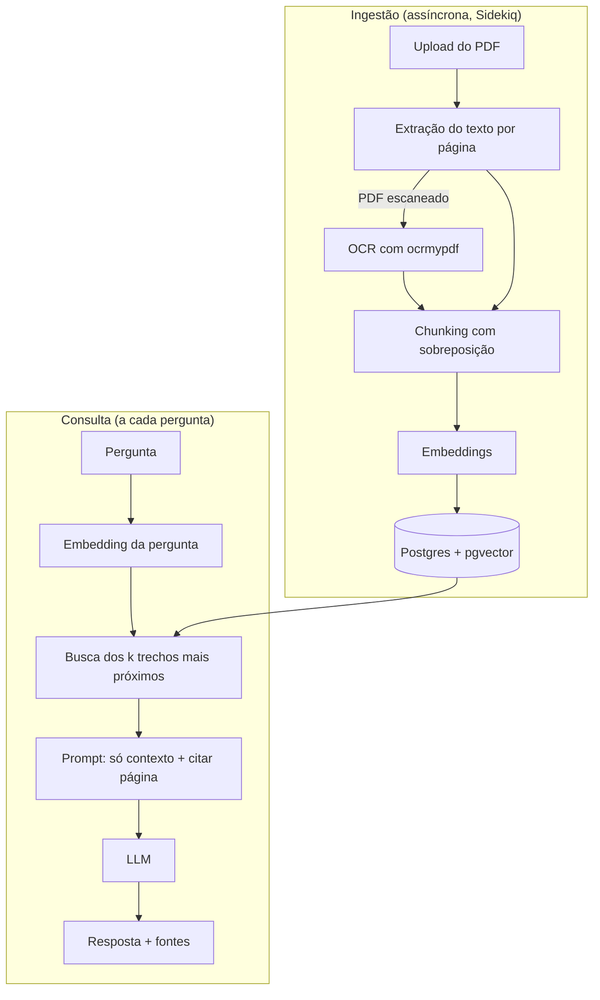

# rag_rails

Um RAG (Retrieval-Augmented Generation) em **Ruby on Rails** que responde perguntas sobre um PDF e **cita a página** de onde tirou a resposta.

> **Projeto de estudo.** Não é um serviço hospedado nem um produto: você roda localmente com a sua própria chave de API e o seu próprio PDF. O código é independente e não é afiliado a nenhuma marca de veículo ou fabricante citada em exemplos.

## Sumário

- [Como funciona](#como-funciona)
- [Stack](#stack)
- [Início rápido](#início-rápido)
- [Configuração](#configuração)
- [Usando a API](#usando-a-api)
- [Avaliando a qualidade](#avaliando-a-qualidade)
- [Estrutura do projeto](#estrutura-do-projeto)
- [Decisões de design](#decisões-de-design)
- [Limitações conhecidas](#limitações-conhecidas)
- [Segurança e privacidade](#segurança-e-privacidade)
- [Solução de problemas](#solução-de-problemas)
- [Roadmap](#roadmap)
- [Contribuindo](#contribuindo)
- [Licença](#licença)

## Como funciona

O fluxo tem duas fases: **ingestão** (uma vez por PDF) e **consulta** (a cada pergunta).



1. **Extração:** o texto é lido página por página; se o PDF não tiver texto (escaneado), roda OCR.
2. **Chunking:** cada página é dividida em trechos de ~3000 caracteres com 400 de sobreposição, guardando o número da página.
3. **Embeddings:** cada trecho vira um vetor (1536 dimensões) salvo no Postgres com pgvector.
4. **Consulta:** a pergunta também vira vetor, e os trechos mais próximos (distância de cosseno) entram no prompt.
5. **Resposta:** o modelo é instruído a responder **somente** com o contexto, citar a página (`[p. 3]`) e dizer "Não encontrei isso no documento." quando o contexto não cobrir a pergunta.

## Stack

| Camada | Tecnologia |
|---|---|
| API | Ruby on Rails (API-only) + Grape |
| Jobs | Sidekiq + Redis |
| Banco | PostgreSQL + pgvector (gem `neighbor`) |
| Arquivos | Active Storage (disco local) |
| Extração de PDF | `pdf-reader`; OCR com `ocrmypdf` + Tesseract |
| Embeddings e geração | Gemini (API REST, sem SDK) |
| Infra local | Docker Compose |

## Início rápido

### Pré-requisitos

- Docker e Docker Compose
- Uma chave de API do Gemini (crie no Google AI Studio)
- Um PDF para testar

### Passo a passo

```bash
git clone https://github.com/diiegopaiivam/rag_rails.git
cd rag_rails

cp .env-example .env                 # preencha GEMINI_API_KEY
docker compose build
docker compose run --rm web bin/rails active_storage:install
docker compose up -d
docker compose exec web bin/rails db:migrate   # se as tabelas ainda não existirem

curl localhost:3000/up               # deve responder 200
```

Acompanhe os logs com `docker compose logs -f web sidekiq`.

### O que sobe

| Serviço | Função | Porta no host |
|---|---|---|
| `web` | API Rails | 3000 |
| `sidekiq` | Processa a ingestão dos PDFs | — |
| `db` | Postgres 16 com pgvector | 5433 |
| `redis` | Fila do Sidekiq | — |

> `web` e `sidekiq` compartilham o volume do projeto: o upload é salvo em `storage/` pelo `web` e lido pelo `sidekiq`. Se você separar os volumes, a ingestão falha por não achar o arquivo.

## Configuração

Variáveis de ambiente (arquivo `.env`):

| Variável | Obrigatória | Descrição | Padrão |
|---|---|---|---|
| `GEMINI_API_KEY` | sim | Chave da API do Gemini | — |
| `GEMINI_LLM_MODEL` | não | Modelo de geração | `gemini-2.5-flash` |
| `GEMINI_EMBED_MODEL` | não | Modelo de embeddings | `gemini-embedding-001` |

> Deixe `GEMINI_LLM_MODEL` e `GEMINI_EMBED_MODEL` **comentadas ou ausentes** se quiser os padrões. Uma variável presente e vazia pode ser lida como string vazia. Confira os nomes de modelos vigentes na documentação do Gemini, pois eles mudam com frequência.

Parâmetros do pipeline (ajuste olhando o resultado da [avaliação](#avaliando-a-qualidade)):

| Parâmetro | Onde | Valor | Efeito |
|---|---|---|---|
| `SIZE` | `Chunker` | 3000 caracteres | Tamanho máximo do trecho |
| `OVERLAP` | `Chunker` | 400 caracteres | Repetição entre trechos vizinhos |
| `TOP_K` | `RagAnswerer` | 6 | Quantos trechos vão para o prompt |
| Dimensão | migration | 1536 | Precisa bater com o modelo de embedding |

## Usando a API

### Enviar um PDF

```bash
curl -F "file=@manual.pdf" localhost:3000/api/v1/documents
# {"id": 1, "status": "pending"}
```

Aceita apenas PDF, até 50 MB. A indexação roda em background.

### Acompanhar a indexação

```bash
curl localhost:3000/api/v1/documents/1
# {"id":1,"title":"manual.pdf","status":"ready","pages":412,"chunks":530,"error":null}
```

Estados: `pending` → `processing` → `ready` (ou `failed`, com o motivo em `error`).

### Fazer uma pergunta

```bash
curl -X POST localhost:3000/api/v1/documents/1/ask \
  -H "Content-Type: application/json" \
  -d '{"question": "Qual a pressão recomendada dos pneus?"}'
```

```json
{
  "answer": "A pressão recomendada é ... [p. 123]",
  "sources": [
    { "page": 123, "snippet": "trecho do documento...", "distance": 0.231 }
  ]
}
```

Perguntar a um documento que ainda não está `ready` retorna `409`.

## Avaliando a qualidade

"Parece funcionar" não é métrica. O projeto inclui um avaliador que roda um conjunto de perguntas com respostas conferidas por você.

1. Edite `eval/golden.yml` com perguntas do **seu** documento:

```yaml
- question: "Qual a pressão recomendada dos pneus?"
  expected_pages: [123]      # índice da página no PDF (começa em 1), NÃO o número impresso
  must_include: ["32"]       # trechos que a resposta correta precisa conter

- question: "Qual a capital da França?"
  should_refuse: true        # fora do escopo: o certo é "Não encontrei"
```

2. Rode:

```bash
docker compose exec web bin/rails rag:eval DOCUMENT_ID=1 SLEEP=1
```

`SLEEP=1` espera 1 segundo entre as perguntas, útil para respeitar limites de cota.

### O que é medido

| Métrica | Pergunta que responde |
|---|---|
| Recuperação | A página certa apareceu entre os trechos recuperados? |
| Resposta correta | A resposta contém o que deveria? |
| Recusa correta | Nas perguntas fora do escopo, o modelo recusou? |
| Citações válidas | O modelo só cita páginas que realmente recebeu? |

Cada falha é classificada como **recuperação** (a página certa não veio), **geração** (veio, mas a resposta saiu errada) ou **alucinação** (deveria ter recusado). Essa distinção diz o que ajustar: chunking e `TOP_K` para recuperação, prompt e modelo para geração.

### Dicas

- Use 15 a 20 perguntas no mínimo; com poucas, uma resposta vale vários pontos percentuais.
- Misture tipos: fatos pontuais, paráfrases, termos exatos, procedimentos e perguntas fora do escopo.
- Mude **uma variável por vez** e compare os resultados.
- A checagem é por trecho de texto e erra quando a resposta certa vem escrita de outro jeito. Revise as falhas manualmente.

## Estrutura do projeto

```
app/
├── api/v1/documents.rb          # endpoints Grape (upload, status, ask)
├── jobs/ingest_document_job.rb  # pipeline de ingestão (Sidekiq)
├── models/                      # Document, Chunk (has_neighbors :embedding)
└── services/
    ├── pdf_text_extractor.rb    # extração por página + fallback de OCR
    ├── chunker.rb               # divisão em trechos com sobreposição
    ├── embedder.rb              # embeddings via Gemini
    ├── llm_client.rb            # geração via Gemini
    └── rag_answerer.rb          # busca vetorial + prompt + resposta
db/migrate/                      # extensão vector, documents, chunks
eval/golden.yml                  # perguntas de teste
lib/tasks/rag_eval.rake          # rake rag:eval
docker-compose.yml               # web, sidekiq, db (pgvector), redis
```

> Se a estrutura do seu repositório diferir, ajuste esta seção.

## Decisões de design

- **pgvector em vez de um banco vetorial dedicado.** Para algumas centenas de milhares de trechos, o Postgres resolve, mantém os dados em um só lugar e dá consistência transacional (apagar um documento apaga seus chunks).
- **Ingestão assíncrona.** Extrair texto e gerar embeddings é lento; o upload responde na hora e o Sidekiq faz o trabalho.
- **Chunking por página.** Preserva o número da página para a citação, ao custo de não juntar texto que atravessa páginas.
- **Embeddings de 1536 dimensões.** Cabem no índice HNSW do pgvector e dão boa qualidade.
- **Camada de provedor isolada.** `Embedder` e `LlmClient` concentram as chamadas ao Gemini. Trocar de provedor (Ollama, OpenAI...) significa reescrever essas duas classes, ajustar a dimensão do vetor se necessário e **reindexar** os documentos: embeddings de modelos diferentes não se misturam.
- **Prompt de ancoragem.** O modelo só responde com o contexto fornecido, cita a página e admite quando não sabe.
- **Active Storage.** Já faz parte do Rails e evita uma dependência extra para guardar os PDFs.

## Limitações conhecidas

- **Tabelas** saem com colunas misturadas na extração de texto, o que prejudica perguntas sobre elas.
- **Imagens, ícones e diagramas não são lidos**; só o texto entra no índice.
- **Sem busca híbrida.** Termos exatos (códigos, nomes de peças) são mal capturados só por embedding.
- **PDFs com senha** precisam ser desbloqueados antes.
- **A busca é por documento**; não há consulta entre vários PDFs ao mesmo tempo.
- Com muitos documentos, o filtro por `document_id` junto do índice HNSW pode retornar menos de `k` resultados (veja `hnsw.iterative_scan` no pgvector 0.8+).
- **A qualidade depende do documento.** Rode a avaliação com o seu PDF antes de confiar nas respostas, principalmente em temas em que um erro tem consequência.

## Segurança e privacidade

- **A API não tem autenticação.** Não exponha na internet como está.
- As credenciais do `docker-compose.yml` (`postgres/postgres`) são **apenas para desenvolvimento**.
- Nunca faça commit do `.env`. Se uma chave vazar, revogue-a e gere outra.
- O texto do PDF e as perguntas são enviados à API do Gemini. No plano gratuito, o Google pode usar o conteúdo para melhorar seus produtos; consulte os termos vigentes antes de indexar documentos sensíveis.
- **Não inclua PDFs protegidos por direitos autorais neste repositório.** Use o seu próprio documento.

## Solução de problemas

| Sintoma | Causa provável | O que fazer |
|---|---|---|
| `status: failed` | Erro na ingestão | Leia o campo `error` e `docker compose logs sidekiq` |
| Job falha por arquivo não encontrado | `web` e `sidekiq` sem volume compartilhado | Mantenha o volume `.:/app` nos dois |
| "Nenhum texto extraído do PDF" | PDF escaneado sem OCR disponível | Confirme `ocrmypdf` e Tesseract na imagem |
| Erro `extension "vector" is not available` | Postgres sem pgvector | Use a imagem `pgvector/pgvector`; em ambientes com permissão restrita, peça a criação da extensão |
| Erro de dimensão do vetor | Modelo e coluna com tamanhos diferentes | Ajuste a migration e reindexe |
| `429` nas chamadas ao Gemini | Cota excedida | Use `SLEEP` na avaliação; o Sidekiq tenta de novo |
| Nome de modelo vazio na chamada | Variável presente e vazia no `.env` | Comente a linha ou preencha o valor |
| `409` ao perguntar | Documento ainda não indexado | Aguarde `status: ready` |

## Roadmap

- [ ] Busca híbrida (vetorial + `tsvector`)
- [ ] Modo de avaliação só de recuperação (sem chamar o LLM)
- [ ] Chunking por seção, repetindo o título em cada trecho
- [ ] Streaming da resposta
- [ ] Consulta entre vários documentos
- [ ] Autenticação e limite de requisições
- [ ] Testes automatizados do `Chunker` e do extrator

## Contribuindo

Issues e pull requests são bem-vindos. Ao reportar um problema de qualidade, inclua o tipo de documento, a pergunta, o `TOP_K` e a configuração de chunking usados, e, se possível, o resultado do `rag:eval`.

## Licença

Distribuído sob a licença MIT. Veja o arquivo `LICENSE`.
